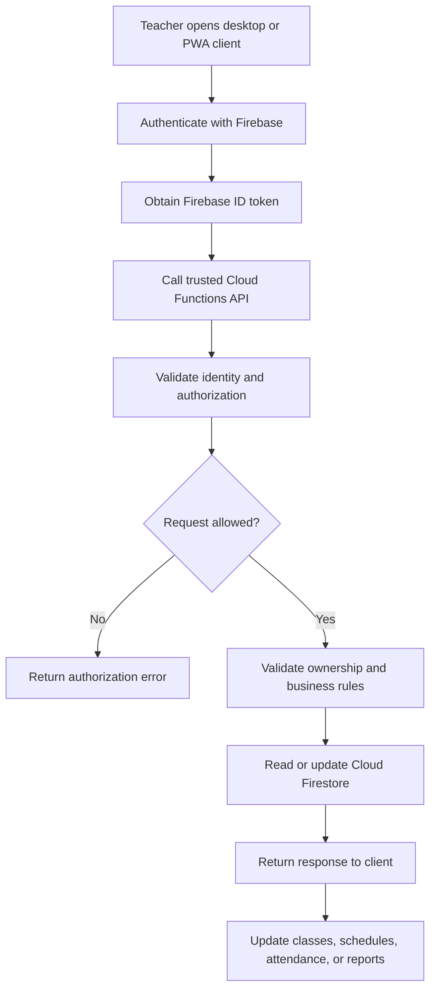

# GURUPRO

**Teacher Attendance & Class Management System**

A desktop-first school administration application with a browser-based companion experience.

---

## Overview

GuruPro is a school-management project designed to organize teacher workflows around classes, teaching schedules, attendance, reports, and paired devices. The primary desktop client is built with Python and PyQt6. A separate browser-oriented PWA and Firebase backend are maintained in the gurupro_remote directory.

The repository emphasizes a trusted server boundary: desktop and browser clients authenticate with Firebase Authentication and communicate with the backend API rather than accessing Firestore through the Firebase Admin SDK from client code.

## Product areas

- Teacher sign-in and profile-oriented access.
- Class and student management.
- Teaching schedules and session records.
- Attendance entry and reporting.
- Device pairing and remote access flows.
- Browser-based PWA experience.
- Server-side validation for identity, ownership, attendance records, and session operations.

## Architecture

    Desktop client (Python / PyQt6)
            │
            │ Firebase ID token
            ▼
    Firebase Cloud Functions API
            │
            ├── Authentication and authorization
            ├── UID / NIP ownership checks
            ├── Class and student operations
            ├── Attendance validation
            └── Firestore access through Admin SDK
                    │
                    ▼
                Cloud Firestore

The PWA and desktop client are untrusted clients. Authorization and data validation must remain enforced by the backend and Firestore Rules.

## Teacher workflow and trusted data flow

## Technology

| Layer | Technology |
| --- | --- |
| Desktop | Python, PyQt6 |
| Browser client | HTML, CSS, JavaScript, PWA |
| Authentication | Firebase Authentication |
| Backend | Firebase Cloud Functions, Firebase Admin SDK |
| Database | Cloud Firestore |
| Password handling | PBKDF2-HMAC-SHA256 utilities |
| Testing | Python unittest, Node.js tests, Firestore Rules tests |
| Hosting configuration | Firebase Hosting |

## Getting started

### Desktop client

Use Python 3.11 or newer for the CI-aligned test environment. Install the desktop dependencies required by the source, including PyQt6 and the libraries used for reporting, QR generation, and API communication.

    git clone https://github.com/gusti111/GuruPro.git
    cd GuruPro

    python -m venv .venv

Windows:

    .venv\Scripts\activate

macOS / Linux:

    source .venv/bin/activate

The repository currently does not provide a pinned root requirements.txt. Install the dependencies required by your local environment before launching:

    python main.py

### Firebase project

The Firebase application and Functions configuration is maintained in gurupro_remote/.

    cd gurupro_remote
    npm install

    cd functions
    npm install

Configure the Firebase project, secrets, approved teacher records, and emulator environment before testing authentication or deployment. See SECURITY.md for the full security and deployment checklist.

## Configuration

The current default project alias is gurupro-app-bc6cc. Configure the required secrets through Firebase Functions Secret Manager rather than placing them in browser or desktop source:

    firebase functions:secrets:set FIREBASE_WEB_API_KEY
    firebase functions:secrets:set GURUPRO_REGISTRATION_CODE

Registration uses an approved NIP record and a one-time administrative registration code. Never commit service-account JSON or production secrets.

## Verification

Run the Python test suite:

    python -m unittest discover -s tests -v

Compile the relevant desktop and backend Python source:

    python -m compileall -q backend controllers main.py

From gurupro_remote/functions, run:

    npm test

From gurupro_remote, run the Firestore Rules tests:

    npm run test:rules

These commands describe the repository's available checks; this README does not claim that a live Firebase deployment or production migration has been completed.

## Repository structure

    GuruPro/
    ├── backend/             # Desktop API client and data access helpers
    ├── controllers/         # Desktop workflow controllers
    ├── ui/                  # Qt Designer interface files
    ├── tests/               # Python unit and security tests
    ├── gurupro_remote/
    │   ├── functions/       # Trusted backend API
    │   ├── firestore.rules
    │   ├── firestore.indexes.json
    │   └── PWA and Hosting assets
    ├── remote_web/          # Browser client assets
    ├── SECURITY.md
    └── main.py

## Security and deployment

- Review SECURITY.md before using real teacher or student records.
- Back up Firestore before any rules or data migration.
- Confirm that all deployed clients use the trusted API before denying direct client Firestore access.
- Test enrollment, ownership boundaries, token revocation, and attendance validation in the Firebase Emulator Suite.
- Treat a passing unit test as a code-level check, not as proof of production security.

## Project status

A source repository with desktop, browser, backend, security, and test components. Live deployment, production data migration, credential rotation, and end-to-end acceptance must be verified independently.

## Author

**Gusty Faqikh** · [GitHub](https://github.com/gusti111)